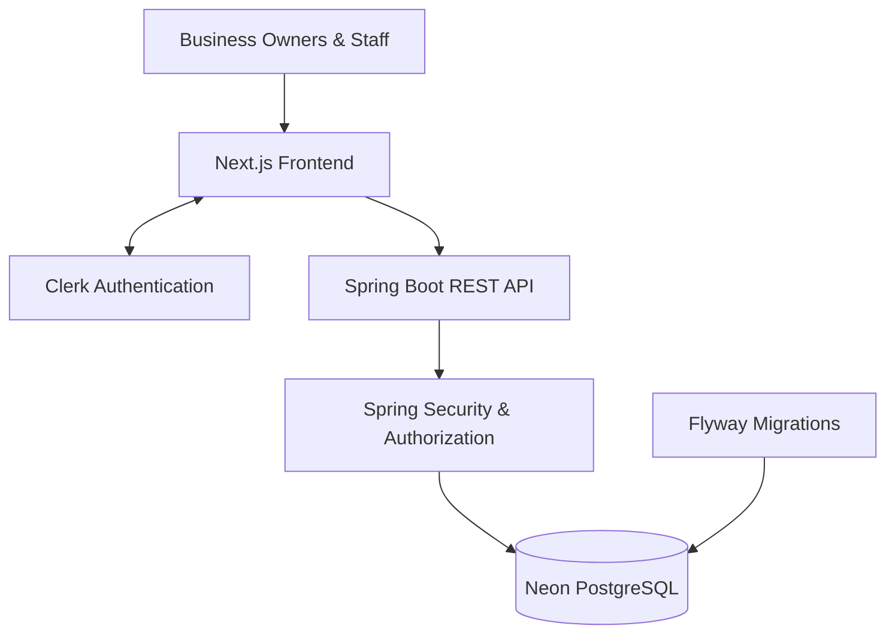

# MyBoss — Multi-Tenant Business Operations Platform

A centralized business operations platform designed to help small business owners manage their teams, organize daily operations, and establish their online presence.

**[Live Application](https://myboss-six.vercel.app/)** · **[GitHub Repository](https://github.com/ravishanamina174/MyBoss.website)**

---

## Overview

**MyBoss** is a multi-tenant business operations platform that brings essential small-business management capabilities into one centralized workspace.

Business owners can publish professional business profiles and shareable digital business cards, manage staff members, assign and track tasks, monitor business operations, and manage their teams through a unified dashboard.

The platform provides separate owner and staff experiences with business-scoped data access and role-based authorization.

## Key Features

### Business Presence
- Create and publish professional business profiles.
- Manage business descriptions, contact information, addresses, images, and social links.
- Create and publish shareable digital business cards.
- Provide publicly accessible business pages.

### Staff Management
- Generate secure staff invitation links with 24-hour expiration.
- Manage staff memberships and account statuses.
- Support separate owner and staff permissions.
- Replace previous pending invitations when generating new ones.

### Task Management
- Create, assign, and manage business tasks.
- Track task progress and completion.
- Allow staff members to complete their assigned tasks.
- Manage task deadlines and monitor overdue work.

### Operations & Insights
- Centralized business dashboard.
- Business activity notifications.
- Staff and task management summaries.
- Operational reports and analytics.

## Engineering Highlights

### Multi-Tenant Architecture
Designed a shared application architecture that supports multiple businesses while enforcing business-level data isolation.

### Authentication & Authorization
Integrated Clerk authentication with Spring Security to manage authenticated users and enforce owner/staff authorization.

### Secure Staff Invitations
Implemented time-limited staff invitation workflows with token-based acceptance, expiration, and replacement of previous pending invitations.

### Database Management
Used PostgreSQL with Flyway for relational data management and version-controlled database schema migrations.

### Automated Security Testing
Verified multi-tenant security through **26 PostgreSQL-backed integration tests**, achieving a **100% test pass rate** across cross-business data isolation, role-based authorization, and staff workflows.

- PostgreSQL 16 integration test database.
- HTTP-level security testing with MockMvc.
- Flyway migration verification (V1–V4).
- Isolated local test database without Docker or production database access.

## Technology Stack

| Category | Technologies |
|---|---|
| Frontend | Next.js, React, TypeScript |
| Styling | Tailwind CSS |
| Backend | Java 21, Spring Boot |
| Database | PostgreSQL, Neon |
| Authentication & Security | Clerk, Spring Security |
| Database Migrations | Flyway |
| Testing | JUnit, MockMvc |
| Containerization | Docker |
| Deployment | Vercel, Render |

## System Architecture



The frontend communicates with the Spring Boot REST API. Clerk handles user authentication, while Spring Security protects backend resources and enforces authorization. PostgreSQL stores business, membership, task, invitation, notification, and profile data.

## Project Structure

```text
MyBoss.website/
│
├── backend/
│   ├── src/
│   │   ├── main/
│   │   │   ├── java/
│   │   │   └── resources/
│   │   │       └── db/migration/
│   │   └── test/
│   ├── Dockerfile
│   ├── TESTING.md
│   └── pom.xml
│
├── frontend/
│   ├── app/
│   ├── components/
│   ├── lib/
│   └── package.json
│
├── docs/
├── DEPLOYMENT.md
└── README.md
```

## Getting Started

### Prerequisites

- Node.js and npm
- Java 21
- PostgreSQL
- Clerk application credentials

### 1. Clone the Repository

```bash
git clone https://github.com/ravishanamina174/MyBoss.website.git
cd MyBoss.website
```

### 2. Configure the Backend

Navigate to the backend directory:

```bash
cd backend
```

Configure the following environment variables:

```env
DB_URL=jdbc:postgresql://localhost:5432/myboss
DB_USERNAME=your_database_username
DB_PASSWORD=your_database_password

CLERK_ISSUER=your_clerk_issuer
CLERK_JWKS_URI=your_clerk_jwks_uri

CORS_ALLOWED_ORIGINS=http://localhost:3000
APP_FRONTEND_URL=http://localhost:3000
```

Create a PostgreSQL database named `myboss`. Flyway automatically manages the database schema migrations.

Start the backend:

```bash
./mvnw spring-boot:run
```

The backend runs on port `8080` by default.

### 3. Configure the Frontend

Open another terminal and navigate to the frontend directory:

```bash
cd frontend
npm install
```

Create a `.env.local` file:

```env
NEXT_PUBLIC_API_URL=http://localhost:8080

NEXT_PUBLIC_CLERK_PUBLISHABLE_KEY=your_clerk_publishable_key
CLERK_SECRET_KEY=your_clerk_secret_key

NEXT_PUBLIC_CLERK_SIGN_IN_URL=/sign-in
NEXT_PUBLIC_CLERK_SIGN_UP_URL=/sign-up

NEXT_PUBLIC_CLERK_SIGN_IN_FALLBACK_REDIRECT_URL=/dashboard
NEXT_PUBLIC_CLERK_SIGN_UP_FALLBACK_REDIRECT_URL=/dashboard
```

Start the frontend:

```bash
npm run dev
```

Open the application:

```text
http://localhost:3000
```

## Backend Testing

MyBoss includes PostgreSQL-backed integration tests to verify multi-tenant security and authorization.

A dedicated local PostgreSQL test database is used to keep automated tests isolated from the production Neon database.

### Run the Tests

Create the test database:

```bash
createdb -h 127.0.0.1 -p 5432 myboss_security_test
```

Navigate to the backend directory and execute:

```bash
cd backend

TEST_DB_URL=jdbc:postgresql://127.0.0.1:5432/myboss_security_test \
TEST_DB_USERNAME=your_local_postgres_user \
TEST_DB_PASSWORD=your_local_postgres_password \
./mvnw clean test
```

### Verified Test Results

| Metric | Result |
|---|---:|
| Tests Executed | 26 |
| Tests Passed | 26 |
| Failures | 0 |
| Errors | 0 |
| Skipped | 0 |
| Test Pass Rate | 100% |
| PostgreSQL Version | 16 |
| Flyway Migrations Verified | V1–V4 |

**Testing note:** These results cover the implemented application-level security and authorization scenarios. Validation against real production Clerk JWT claims is not included in this test result.

For additional testing instructions, see [backend/TESTING.md](backend/TESTING.md).

## Deployment

MyBoss uses a separate frontend and backend deployment architecture.

| Component | Platform |
|---|---|
| Frontend | Vercel |
| Backend | Render |
| Database | Neon PostgreSQL |
| Authentication | Clerk |

For deployment configuration and required environment variables, see [DEPLOYMENT.md](DEPLOYMENT.md).

## Project Status

MyBoss is an actively developed software engineering project focused on building a practical, secure, and maintainable business operations platform.

## Author

**Ravisha Abeysekara**

Software Engineering Undergraduate · Full-Stack Developer

- **LinkedIn:** [linkedin.com/in/ravisha-abeysekara](https://www.linkedin.com/in/ravisha-abeysekara)
- **GitHub:** [github.com/ravishanamina174](https://github.com/ravishanamina174)
- **Portfolio:** [ravisha.online](https://ravisha.online)

---

*Built to simplify everyday business operations through thoughtful software engineering.*
